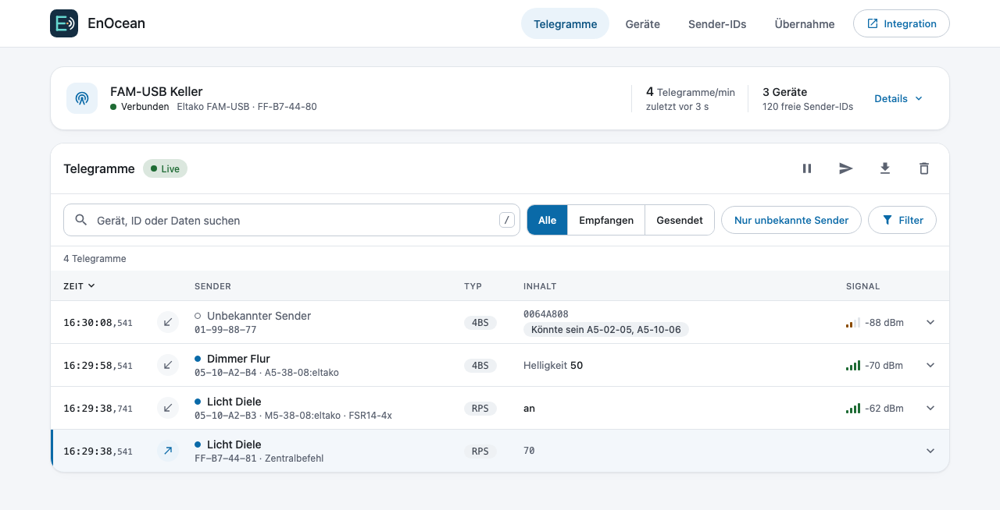
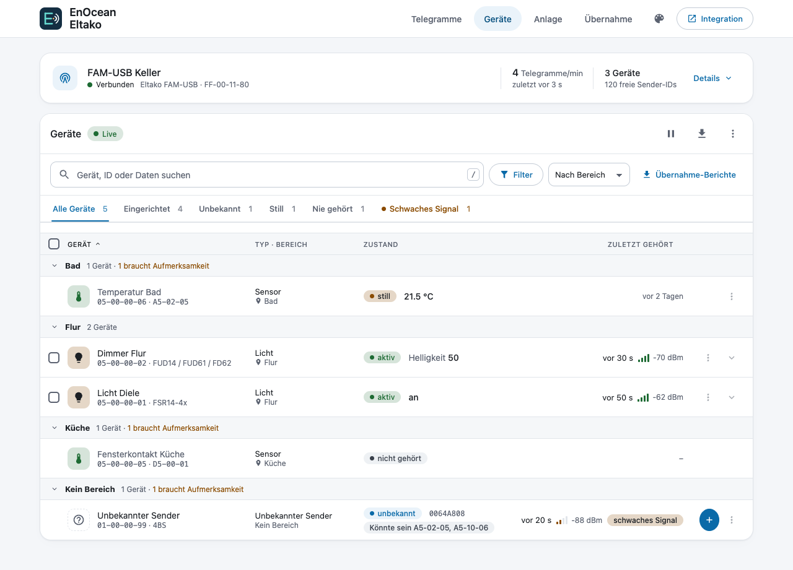
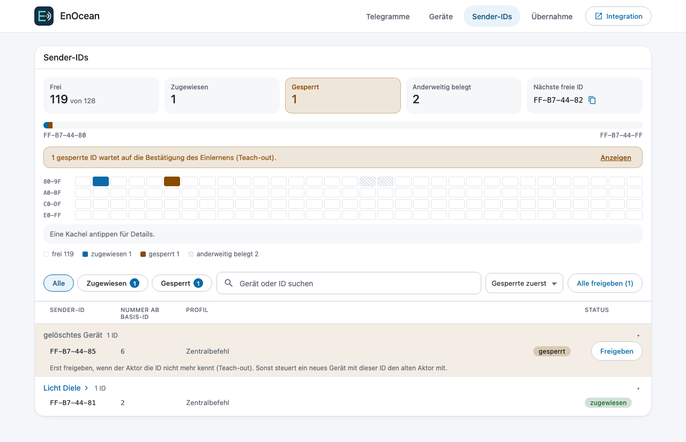
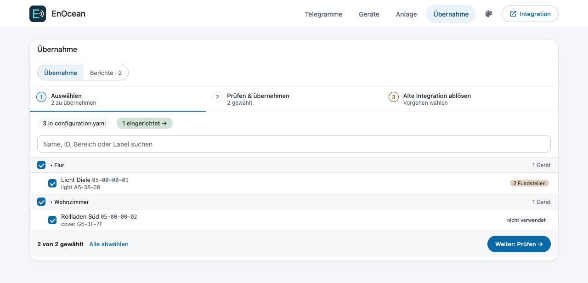
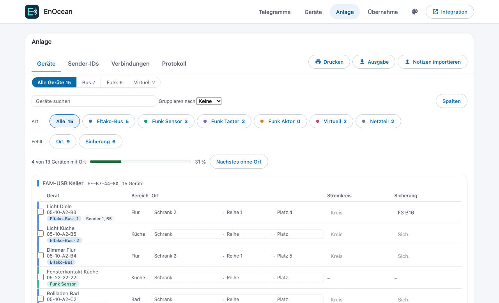
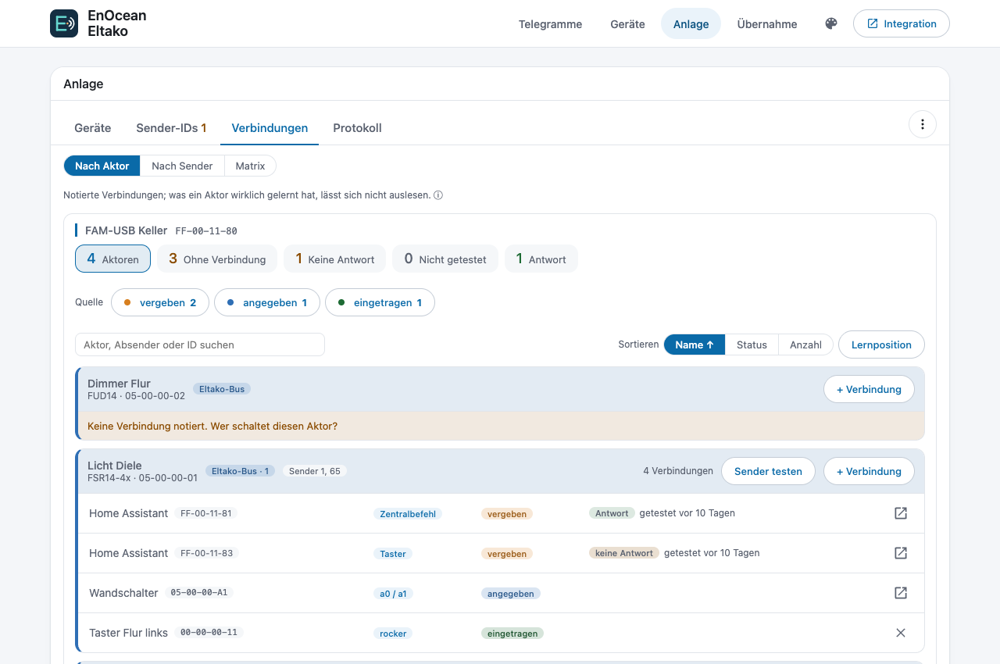
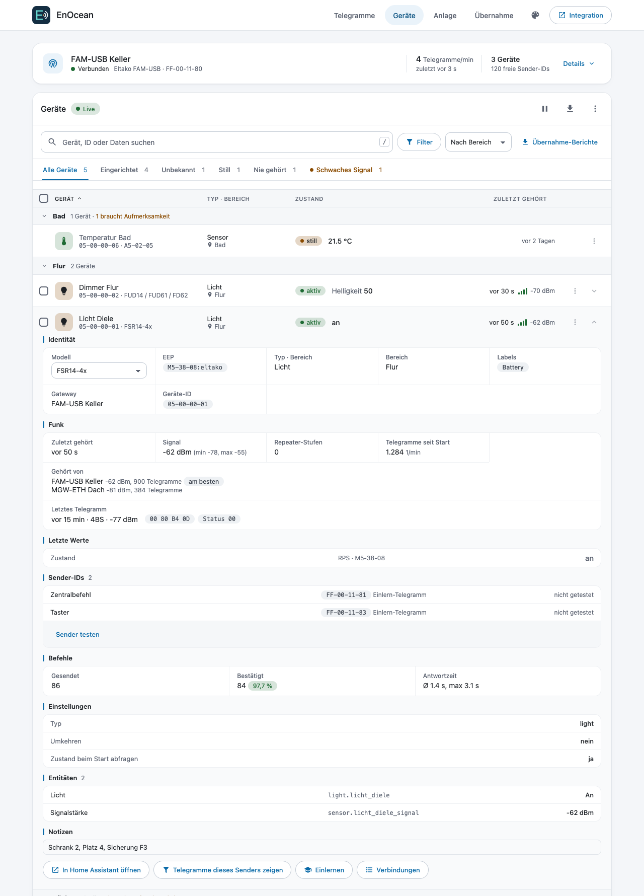
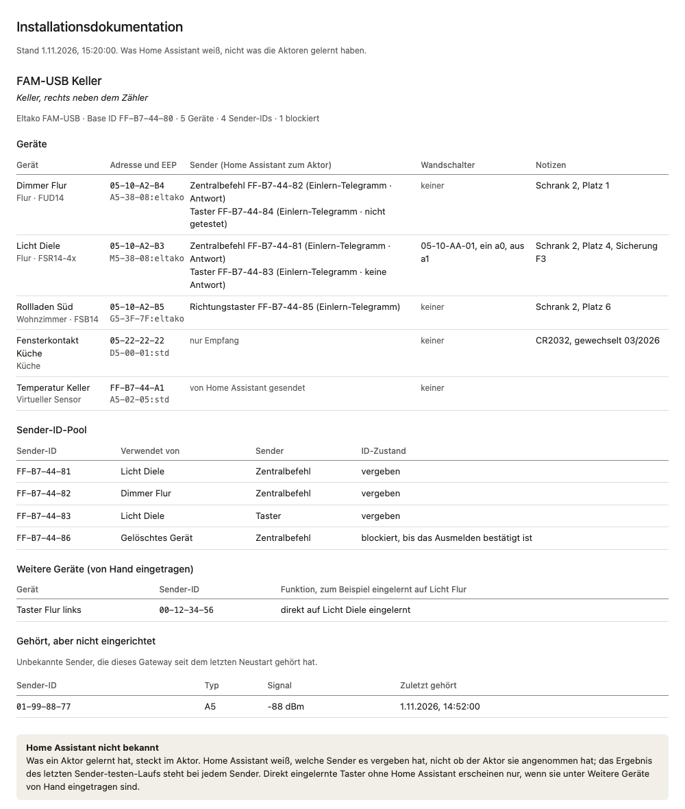
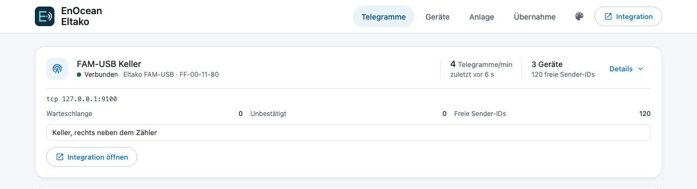

<h1 align="center">EnOcean Eltako für Home Assistant</h1>

  Eltako- und EnOcean-Geräte in Home Assistant, komplett über die Oberfläche eingerichtet.

  
  
  
  
  

  
  
  

<em><a href="README.md">English version</a></em>

> [!IMPORTANT]
> **App Device Proxy (empfohlen):** Die App [Device Proxy](https://github.com/bertel2020/HA-Device-Proxy) für Home Assistant OS und Supervised behält die serielle Schnittstelle des Gateways und teilt sie: Home Assistant, die alte Integration `eltako`, eo_man oder PCT14 können ein Gateway gleichzeitig nutzen. Nach einem Neustart liefert sie die verpassten Telegramme nach und kann mit einem Ersatz-Gateway einspringen. Die Integration findet die Gateways der App von selbst. Siehe [Benutzerhandbuch](docs/USER-GUIDE.de.md#app-device-proxy).

EnOcean Eltako bindet Eltako-Geräte (Baureihe 14 am Bus und Funk) und andere EnOcean-Geräte in Home Assistant ein. Die Integration ist neu geschrieben, braucht keine fremde EnOcean-Bibliothek und wird komplett über die Oberfläche eingerichtet: ein Eintrag pro Gateway, ein Untereintrag pro Gerät, kein YAML.

## Highlights

- **Gateways:** Eltako FGW14-USB und FAM14 (RS485-Bus, als Bus-Gruppe mit Failover), FAM-USB, PioTek MGW-ETH, Symcon EnOcean LAN Gateway sowie generische ESP2-/ESP3-Gateways; jedes USB-Gateway auch über ser2net (TCP).
- **Geräte:** Schaltaktoren, Dimmer, Rollläden, Heizungsaktoren und Raumregler, Fenstergriffe, Kontakte, Taster, Zähler, Sensoren, Permundo-Zwischenstecker und VLD-Aktoren. Jedes Standardprofil von EnOcean lässt sich als generisches Gerät anlegen. Vollständige Liste: [docs/devices.de.md](docs/devices.de.md).
- **Rollläden** mit Controller- und Richtungstaster-Sender parallel, Positionsverfolgung, Lüftungsschlitzen, Lamellenstellung und Laufzeit-Assistent.
- **Virtuelle Sensoren:** Home-Assistant-Entitäten als EnOcean-Kontakt, -Bewegungsmelder, -Temperatur, -Helligkeit, -Wetter oder -Taster senden, z. B. für die Beschattungsautomatik eines Aktors.
- **Anlernen, Discovery und ein Live-Telegramm-Monitor** im Seitenleisten-Panel **EnOcean**, dazu Mitschnitt und Diagnosedaten für Fehlerberichte. Drei Farbschemata (hell/dunkel) und drei Schriftgrößen sind wählbar.
- **[App Device Proxy](https://github.com/bertel2020/HA-Device-Proxy):** teilt ein Gateway zwischen Home Assistant und anderen Programmen, liefert die beim Neustart verpassten Telegramme nach und wird anhand ihrer Meldung eingerichtet.
- **Übernahme** der Geräte der alten Integration `eltako`, ohne die Aktoren neu einzulernen.
- **Installationsdokumentation** im Panel: Einbauorte, Stromkreise, Sicherungen, Sender-IDs und Verbindungen, dazu der **Eltako-Bus** nach seinem Master (FAM14) mit jedem Reiheneinbaugerät und seinen Kanälen, Schränken als maßstäbliche Hutschienen mit Etikettenstreifen zum Drucken, dem Adressplan 1–126, der Last der Netzteile und Prüfungen (doppelte und fehlende Adressen, Geräte, die nicht in Home Assistant sind); ein experimentelles Lesen des Busses durch Mithören gleicht die antwortenden Adressen mit der Dokumentation ab.
- **Sicherheit bleibt im Aktor:** Wind-, Regen-, Frost- und Aussperrschutz werden nie ersetzt.

## Screenshots

Die Screenshots zeigen Beispieldaten aus dem Seitenleisten-Panel **EnOcean**.

  

| Geräte | Sender-IDs |
| --- | --- |
|  |  |

| Übernahme |
| --- |
|  |

| Installation: Geräte | Installation: Verbindungen |
| --- | --- |
|  |  |

| Gerätedetails | Installationsdokumentation (Druck) |
| --- | --- |
|  |  |

| Gateway-Details |
| --- |
|  |

## Installation

### Über HACS (empfohlen)

1. Über den ersten Button das EnOcean-Eltako-Repository in HACS öffnen.
2. **EnOcean Eltako** herunterladen und Home Assistant neu starten.
3. Über den zweiten Button die Integration hinzufügen. Alternativ in Home
   Assistant **Einstellungen → Geräte & Dienste → Integration hinzufügen →
   EnOcean Eltako** öffnen.

Falls der erste Button nicht funktioniert, in HACS unter **Integrationen →
Benutzerdefinierte Repositories** `https://github.com/bertel2020/HA-Enocean-Eltako`
als Kategorie **Integration** eintragen.

### Manuell

Das Verzeichnis `custom_components/enocean_eltako` nach
`/config/custom_components/enocean_eltako` kopieren und Home Assistant neu
starten.

## Schnellstart

1. Die Integration pro Gateway einmal hinzufügen und Modell und Anbindung wählen (USB-Port oder Host und Port).
2. Unter dem Gateway **Gerät hinzufügen** wählen: das Gerät durch Tastendruck anlernen oder aus dem Katalog aussuchen. Sender, die das Gateway von selbst hört, stehen dort unter **Entdeckte Geräte**.
3. Im Seitenleisten-Panel (es heißt **EnOcean**, die Integration selbst **EnOcean Eltako**) Telegramme live beobachten und Sender-IDs prüfen.

Jeder Schritt, alle Gerätearten, das Panel, die Übernahme, Blueprints, bekannte Einschränkungen und die Fehlersuche stehen im **[Benutzerhandbuch](docs/USER-GUIDE.de.md)**.

## Dokumentation

- [Benutzerhandbuch](docs/USER-GUIDE.de.md)
- [Unterstützte Geräte](docs/devices.de.md)
- [Einlernfunktionen der Eltako-Aktoren Baureihe 14](docs/teach_in.de.md)
- [Quality Scale](docs/quality_scale.de.md)
- [Änderungsprotokoll](CHANGELOG.md) (Englisch und Deutsch)

## Dank

Diese Integration ist neu geschrieben, wäre aber ohne die Arbeit und Erfahrung dieser Projekte und ihrer Autoren nicht entstanden:

- [grimmpp/home-assistant-eltako](https://github.com/grimmpp/home-assistant-eltako) (Philipp Grimm): die bisherige Eltako-Integration; dort wiederum Dank an chrysn und Johannes Bosecker für die erste Version sowie an Cedric Van Labeke und LHBL2003.
- [grimmpp/eltako14bus](https://github.com/grimmpp/eltako14bus): ursprünglich von Christian Amsüss und Energy Harvesting Solutions (2016–2020), weiterentwickelt von Philipp Grimm.
- [grimmpp/esp2_gateway_adapter](https://github.com/grimmpp/esp2_gateway_adapter) (Philipp Grimm).
- [kipe/enocean](https://github.com/kipe/enocean) (Kimmo Huoman).
- [grimmpp/enocean-device-manager](https://github.com/grimmpp/enocean-device-manager) (eo_man).

Aus diesen Projekten wurde kein Code übernommen. Lizenzpflichten stehen in [LICENSE](LICENSE) und [NOTICE](NOTICE).

## Lizenz

[MIT](LICENSE). EnOcean ist eine eingetragene Marke der EnOcean GmbH, Eltako der Eltako GmbH. Dieses Projekt steht mit keinem der beiden Unternehmen in Verbindung.
