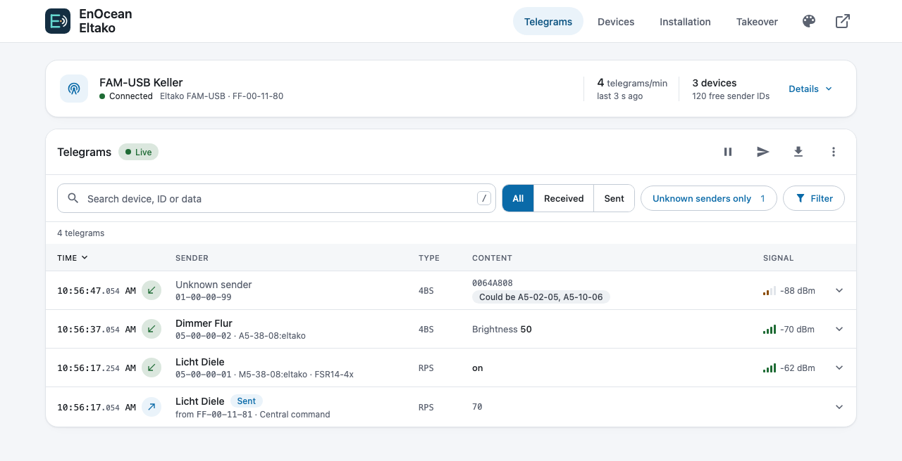
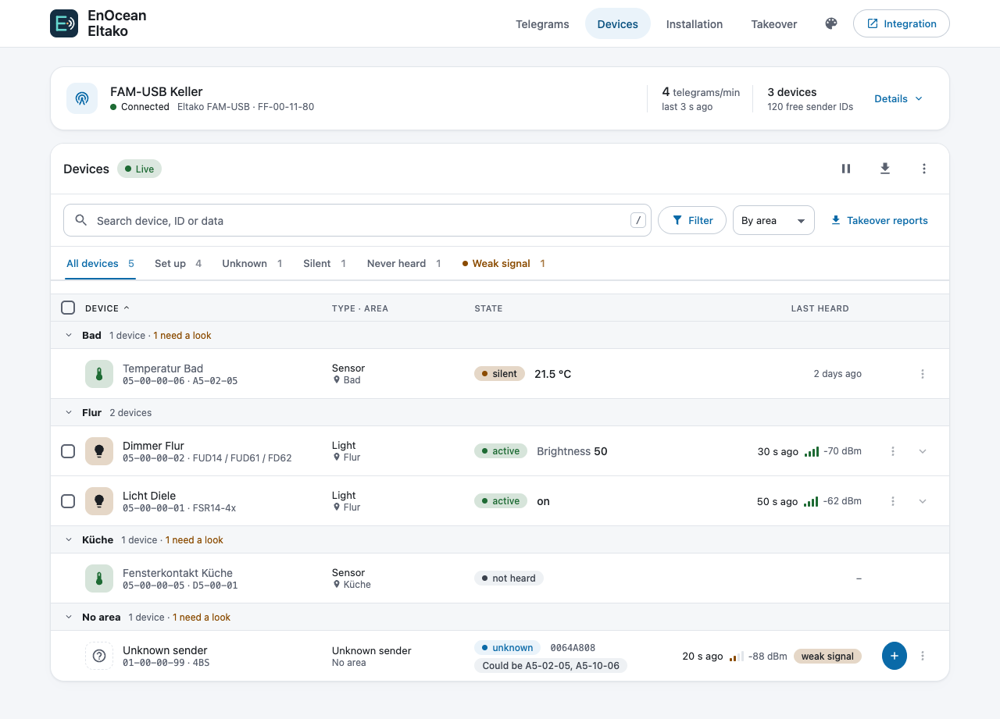
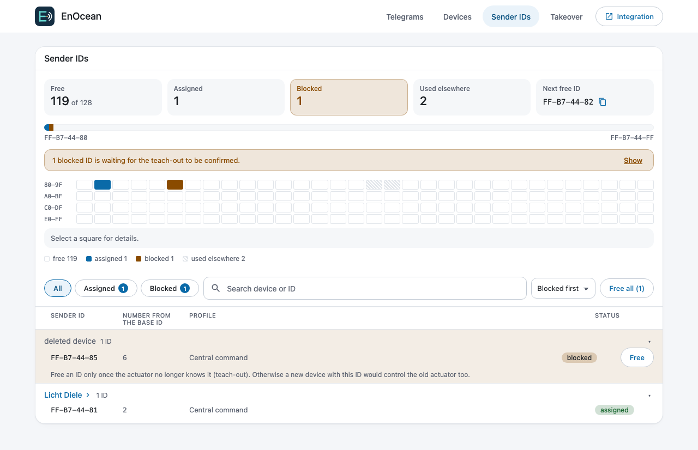
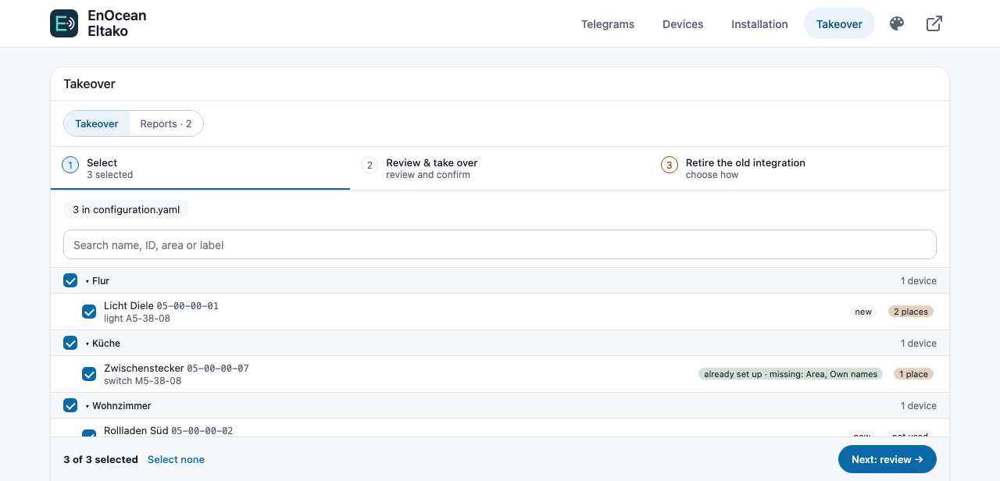
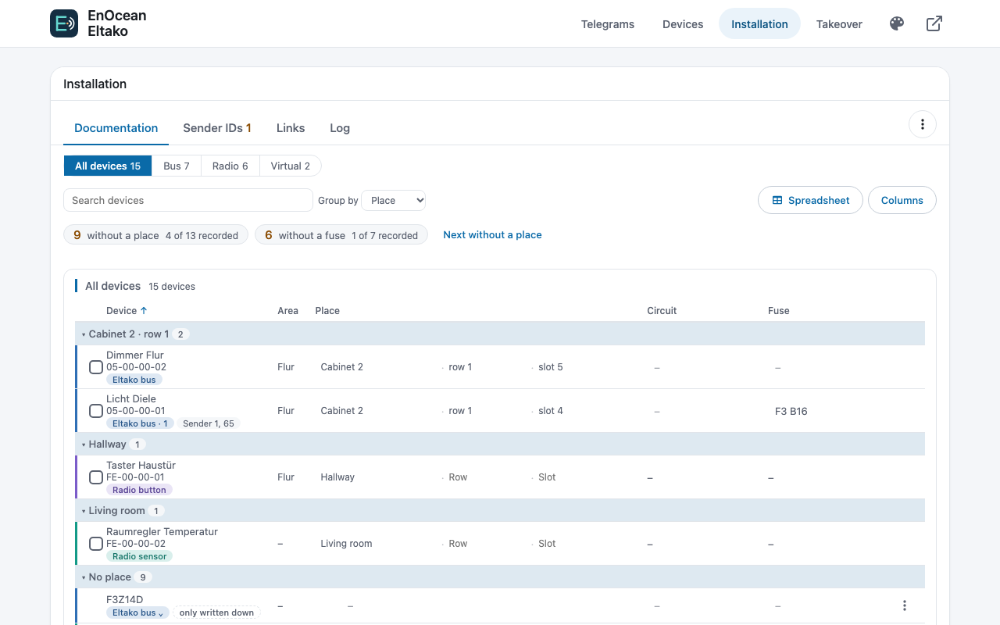
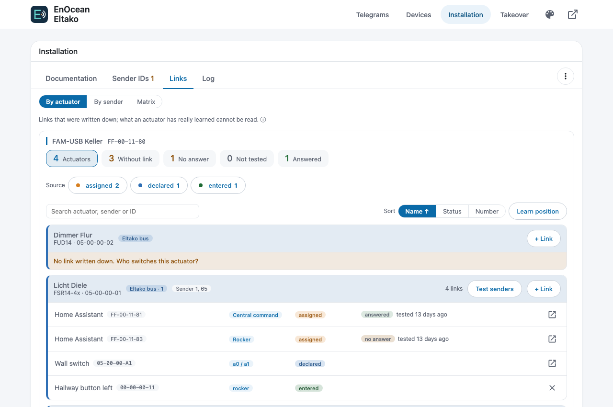
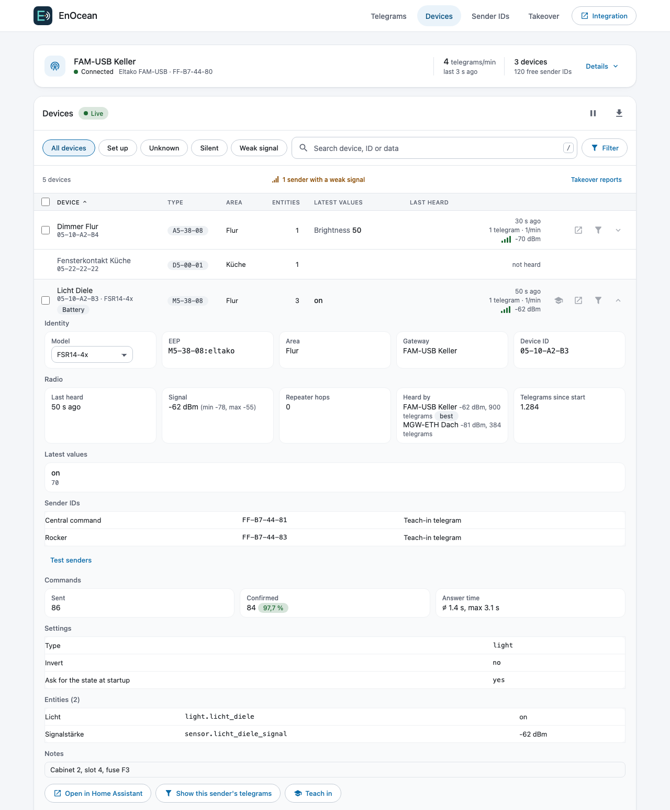
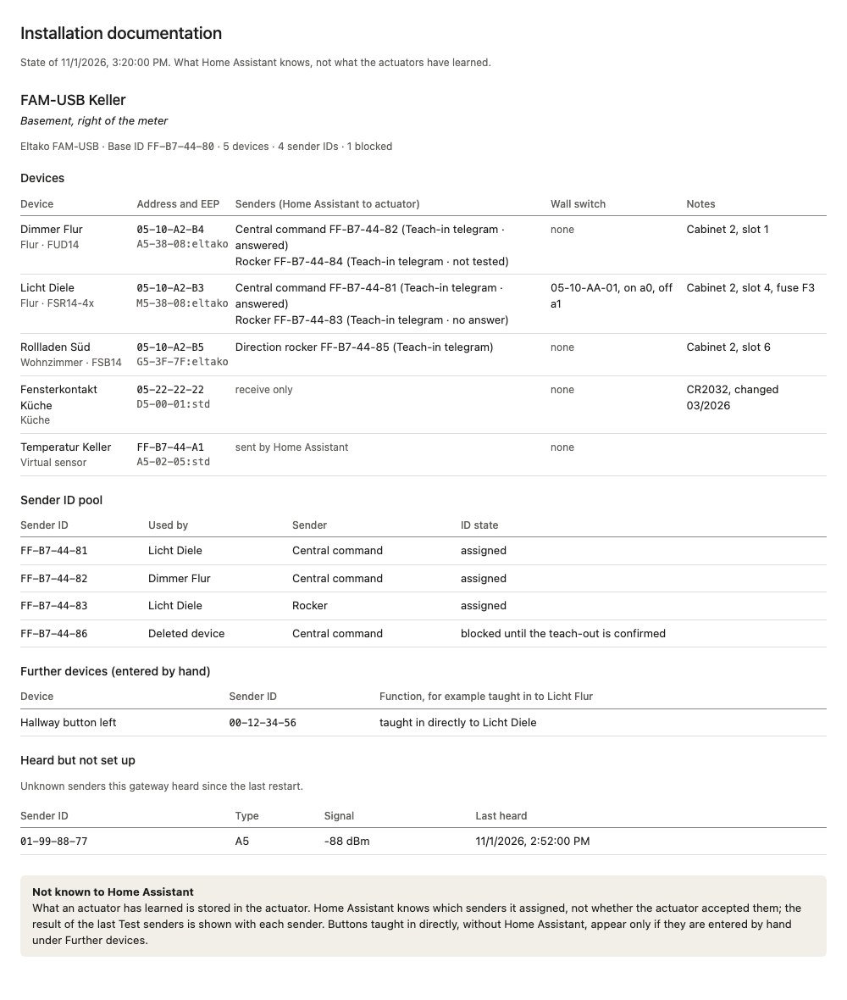
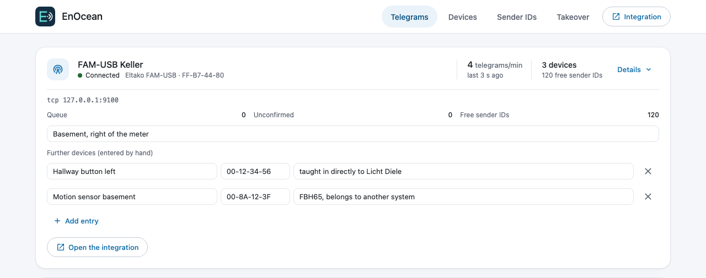

<h1 align="center">EnOcean Eltako for Home Assistant</h1>

  Eltako and EnOcean devices in Home Assistant, configured entirely through the UI.

  
  
  
  
  

  
  
  

<em><a href="README.de.md">Deutsche Version</a></em>

> [!IMPORTANT]
> **Device Proxy app (recommended):** the [Device Proxy](https://github.com/bertel2020/HA-Device-Proxy) app for Home Assistant OS and Supervised keeps the gateway's serial port and shares it: Home Assistant, the old `eltako` integration or a second Home Assistant (a test system, for example) can use one gateway at the same time. After a restart it replays the telegrams Home Assistant missed, and it can stand in with a fallback gateway. The integration finds the app's gateways by itself. See the [User Guide](docs/USER-GUIDE.md#device-proxy-app).

EnOcean Eltako brings Eltako devices (series 14 bus and wireless) and other EnOcean devices into Home Assistant. It is written from scratch, needs no third-party EnOcean library and is configured entirely in the UI: one entry per gateway, one sub-entry per device, no YAML.

## Highlights

- **Gateways:** Eltako FGW14-USB (RS485 bus of the series 14; a FAM14 with an interface of its own joins the same bus group with failover), FAM-USB, PioTek MGW-ETH, Symcon EnOcean LAN Gateway and generic ESP2/ESP3 gateways; every USB gateway also over ser2net (TCP).
- **Devices:** switching actuators, dimmers, shutters, heating actuators and room controllers, window handles, contacts, rockers, meters, sensors, Permundo plugs and VLD actuators. Any of the standard EnOcean profiles can be added as a generic device. Full list: [docs/devices.md](docs/devices.md).
- **Covers** with controller and direction-rocker senders in parallel, position tracking, vent slots, slat tilt and a travel time assistant.
- **Virtual sensors:** Home Assistant entities sent as EnOcean contact, motion, temperature, brightness, weather or rocker, e.g. to feed the shading automatic of an actuator.
- **Teach-in, discovery and a live telegram monitor** in the **EnOcean** sidebar panel, plus capture and diagnostics for bug reports. Three colour schemes (light/dark) and three font sizes are selectable.
- **[Device Proxy app](https://github.com/bertel2020/HA-Device-Proxy):** shares one gateway between Home Assistant and other programs, replays the telegrams missed during a restart and is set up from its announcement.
- **Takeover** of the devices of the old `eltako` integration without teaching the actuators in again.
- **Installation documentation** in the panel: places, circuits, fuses, sender IDs and links, and the **Eltako bus** by its master (FAM14) with each DIN rail device and its channels, cabinets drawn as DIN rails to scale with label strips to print, the address plan 1–126, the load of the power supplies and checks (duplicate addresses, missing ones, devices not in Home Assistant); an experimental reading of the bus by listening compares the addresses that answer with the documentation.
- **Safety stays in the actuator:** wind, rain, frost and lock-out protection are never replaced.

## Screenshots

The screenshots show sample data from the **EnOcean** sidebar panel.

  

| Devices | Sender IDs |
| --- | --- |
|  |  |

| Takeover |
| --- |
|  |

| Installation: documentation | Installation: links |
| --- | --- |
|  |  |

| Device details | Installation documentation (print) |
| --- | --- |
|  |  |

| Gateway details |
| --- |
|  |

## Installation

### Via HACS (recommended)

1. Use the first button to open the EnOcean Eltako repository in HACS.
2. Download **EnOcean Eltako** and restart Home Assistant.
3. Use the second button to add the integration. Alternatively open **Settings
   → Devices & services → Add integration → EnOcean Eltako**.

If the first button does not work, add `https://github.com/bertel2020/HA-Enocean-Eltako`
in HACS under **Integrations → Custom repositories** as category **Integration**.

### Manual

Copy the `custom_components/enocean_eltako` directory to
`/config/custom_components/enocean_eltako` and restart Home Assistant.

## Quick start

1. Add the integration once per gateway and pick the model and connection (USB port, or host and port).
2. Under the gateway choose **Add device**: listen for the device by pressing a button on it, or pick it from the catalog. Senders the gateway hears on its own are listed there under **Discovered devices**.
3. Open the panel in the sidebar (named **EnOcean**; the integration itself is **EnOcean Eltako**) to watch telegrams live and to check sender IDs.

Every step, all device types, the panel, the takeover, blueprints, known limitations and troubleshooting are in the **[User Guide](docs/USER-GUIDE.md)**.

## Documentation

- [User Guide](docs/USER-GUIDE.md)
- [Supported devices](docs/devices.md)
- [Learn functions of Eltako series 14 actuators](docs/teach_in.md)
- [Quality scale](docs/quality_scale.md)
- [Changelog](CHANGELOG.md) ([Deutsch](CHANGELOG.de.md))

## Thanks

This integration is written from scratch, but it would not exist without the work and experience of these projects and their authors:

- [grimmpp/home-assistant-eltako](https://github.com/grimmpp/home-assistant-eltako) (Philipp Grimm): the previous Eltako integration, which in turn thanks chrysn and Johannes Bosecker for the first version as well as Cedric Van Labeke and LHBL2003.
- [grimmpp/eltako14bus](https://github.com/grimmpp/eltako14bus): originally by Christian Amsüss and Energy Harvesting Solutions (2016–2020), maintained by Philipp Grimm.
- [grimmpp/esp2_gateway_adapter](https://github.com/grimmpp/esp2_gateway_adapter) (Philipp Grimm).
- [kipe/enocean](https://github.com/kipe/enocean) (Kimmo Huoman).
- [grimmpp/enocean-device-manager](https://github.com/grimmpp/enocean-device-manager).

No code was taken from these projects. License terms are in [LICENSE](LICENSE) and [NOTICE](NOTICE).

## License

[MIT](LICENSE). EnOcean is a registered trademark of EnOcean GmbH, Eltako of Eltako GmbH. This project is not affiliated with either company.
